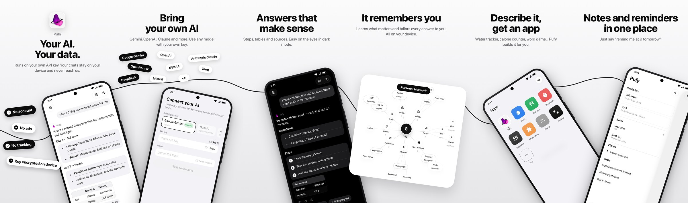
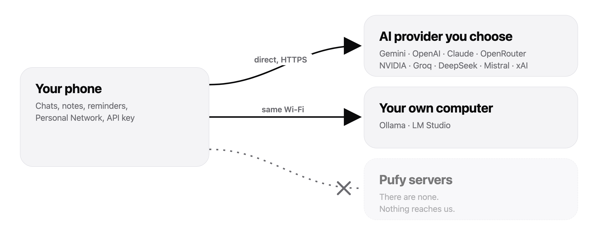

<picture>
  <source media="(prefers-color-scheme: dark)" srcset="docs/images/banner-dark.png">
  
</picture>

<p align="center">
  <b>A personal AI assistant for iPhone and Android that never sends your data to us.</b><br>
  No account. No ads. No tracking. Bring your own AI.
</p>

<p align="center">
  <a href="README.tr.md">Türkçe</a> ·
  <a href="#features">Features</a> ·
  <a href="#privacy">Privacy</a> ·
  <a href="#build-it-yourself">Build it yourself</a> ·
  <a href="#license">License</a>
</p>

<p align="center">
  
</p>

---

## Why Pufy?

Most AI apps want you to sign up, and then they keep your conversations on their servers. Pufy doesn't work that way:

- **Your data stays on your phone.** Chats, notes, reminders and what Pufy learns about you never leave your device. The only exception is the message you send to the AI.
- **You choose the AI.** Paste a key from Google Gemini, OpenAI, Anthropic, OpenRouter, NVIDIA and more. You can also run a model on your own computer with Ollama or LM Studio.
- **There is no Pufy server.** Nothing to sign into, nothing to breach, nothing to sell.

## Features

| | |
|---|---|
| **Chat & research** | Ask anything. Pufy searches the web when it needs to and shows its sources. A deeper research mode works in visible steps. |
| **Reminders & tasks** | "Remind me at 9 tomorrow", timers, and scheduled AI tasks that keep watching for you ("tell me when the price drops"). |
| **Notes** | Notes and checklists you can also edit by talking to Pufy. |
| **Personal Network** | Pufy remembers what matters about you and uses it to tailor its answers. You can see it as a graph and edit or forget anything. All of it is stored on your device. |
| **Build mini apps** | Describe an app ("a water tracker", "a word game") and Pufy writes it. The apps run offline inside Pufy. |
| **Files** | Attach PDF, Word, text and code files; they are read on your device. |
| **Voice** | Dictation with the microphone button. |
| **Rich answers** | Tables, slide decks, quizzes, comparison cards and interactive canvases. |
| **Two languages** | English and Turkish, with answers in your language. |

Other details:
- **Design:** Monochrome, with a Liquid Glass look on iOS 26.
- **Mac:** It also runs on the Mac through Mac Catalyst.

## Privacy

<picture>
  <source media="(prefers-color-scheme: dark)" srcset="docs/images/privacy-flow-en-dark.png">
  
</picture>

- **On your device:**
  - Everything is stored inside the app on your device and protected by your phone's own encryption.
  - The API key is kept in the iOS Keychain or Android encrypted storage.
- **Leaves your device:**
  - **Your messages, attached photos and file text, and dictation audio** go directly to the AI provider you picked, under that provider's privacy policy.
  - **Weather:** The city name goes to Open-Meteo.
  - **Images:** Pictures in answers come from Wikipedia/Wikimedia, with site icons from Google's favicon service.
  - **Mini apps:** They may load open-source libraries from unpkg.com.
  - **Live scores (iOS):** The app reads flashscore.mobi; no user data is sent to it.
- **Not in the app:** No analytics, crash reporting, ads or tracking SDKs. You can check this in the source.

The full list is in [PRIVACY.md](PRIVACY.md).

## Supported AI providers

| Cloud | Local (your computer) |
|---|---|
| Google Gemini (free tier available) · OpenAI · Anthropic Claude · OpenRouter · NVIDIA · Groq · DeepSeek · Mistral · xAI · any OpenAI-compatible server | Ollama · LM Studio |

**Local model setup:**
- **Ollama:** Start it with `OLLAMA_HOST=0.0.0.0 ollama serve` and enter `http://<your-computer-ip>:11434/v1`.
- **LM Studio:** Turn on *Serve on Local Network*, port `1234`.
- Your phone and your computer must be on the same Wi-Fi.

## Build it yourself

The repository contains both apps:

```
ios/       SwiftUI app (iPhone, iPad, Mac Catalyst) + widget / Live Activity
android/   Kotlin + Jetpack Compose app
docs/      images used in this README
```

### iOS

Requirements:
- Xcode 26 or newer (deployment target iOS 16.2)
- [XcodeGen](https://github.com/yonaskolb/XcodeGen)

```bash
brew install xcodegen
cd ios
cp Config/Local.xcconfig.example Config/Local.xcconfig   # put your Apple Team ID in it
xcodegen generate
open PufyAgent.xcodeproj
```

If the bundle identifier `com.pufy.PufyAgent` is already taken on your account, change `bundleIdPrefix` and `PRODUCT_BUNDLE_IDENTIFIER` in `ios/project.yml`.

### Android

Requirements:
- Android Studio (JDK 21)
- minSdk 26, targetSdk 36

Open the `android/` folder in Android Studio and press **Run**, or build from the command line:

```bash
cd android
./gradlew assembleDebug        # app/build/outputs/apk/debug/
./gradlew testDebugUnitTest    # unit + screenshot tests (Robolectric)
```

To build a signed release, copy `keystore.properties.example` to `keystore.properties` and fill it in. Never commit your keystore.

### One system prompt, two apps

The AI instructions are written once, in `ios/ChatViewModel.swift`. The Android copy is generated from it:

```bash
python3 android/scripts/gen_prompts.py
```

## License

Pufy is **source-available** under the [PolyForm Noncommercial License 1.0.0](LICENSE).

- **Allowed:** reading, building, running and modifying it for personal, educational and other noncommercial use.
- **Not allowed without permission:** commercial use, such as selling it, putting it in a paid product or using it in a business.
- The **"Pufy" name and logo are not licensed.** Do not publish builds or forks under the Pufy name or logo, on app stores or anywhere else.

For commercial licensing, open an issue.
