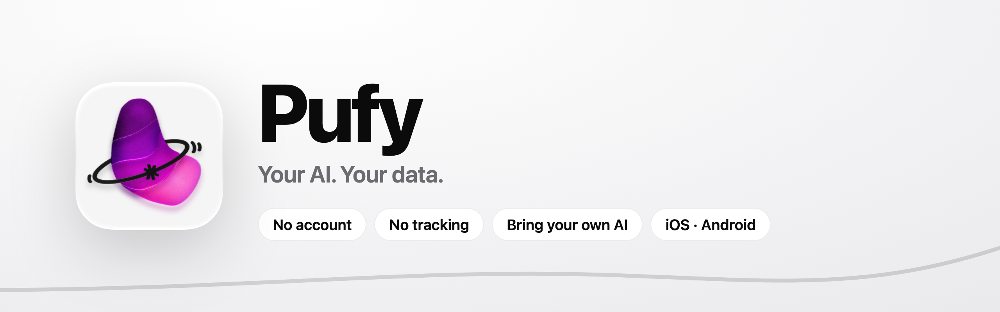
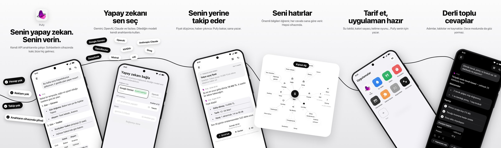
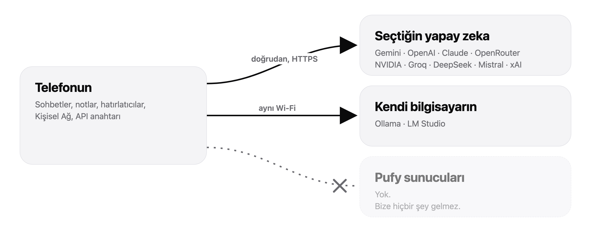

<picture>
  <source media="(prefers-color-scheme: dark)" srcset="docs/images/banner-dark.png">
  
</picture>

<p align="center">
  <b>Verini bize hiç göndermeyen, iPhone ve Android için kişisel yapay zeka asistanı.</b><br>
  Hesap yok. Reklam yok. Takip yok. Kendi yapay zekanı getir.
</p>

<p align="center">
  <a href="README.md">English</a> ·
  <a href="#özellikler">Özellikler</a> ·
  <a href="#gizlilik">Gizlilik</a> ·
  <a href="#kendin-derle">Kendin derle</a> ·
  <a href="#lisans">Lisans</a>
</p>

<p align="center">
  
</p>

---

## Neden Pufy?

Çoğu yapay zeka uygulaması önce hesap açtırır, sonra sohbetlerini kendi sunucularında tutar. Pufy farklı:

- **Verin telefonunda kalır.** Sohbetler, notlar, hatırlatıcılar ve Pufy'nin seninle ilgili öğrendikleri cihazından çıkmaz. Tek istisna, yapay zekaya gönderdiğin mesajın kendisi.
- **Yapay zekayı sen seçersin.** Google Gemini, OpenAI, Anthropic, OpenRouter, NVIDIA ve diğerlerinden birinin anahtarını yapıştır. İstersen Ollama ya da LM Studio ile kendi bilgisayarındaki modeli kullan.
- **Pufy sunucusu yok.** Giriş yapılacak, sızdırılacak ya da satılacak bir veri yok.

## Özellikler

| | |
|---|---|
| **Sohbet ve araştırma** | Her şeyi sor. Gerektiğinde web'de arar ve kaynak gösterir. Derin araştırma adım adım ilerler. |
| **Hatırlatıcı ve görevler** | "Yarın 9'da hatırlat", sayaçlar ve senin yerine takip eden zamanlanmış görevler ("fiyat düşünce haber ver"). |
| **Notlar** | Notlar ve yapılacaklar listeleri. Pufy'ye söyleyerek de düzenleyebilirsin. |
| **Kişisel Ağ** | Pufy seninle ilgili önemli bilgileri hatırlar ve cevaplarını buna göre verir. Ağ olarak görebilir, istediğini düzenleyip unutturabilirsin. Hepsi cihazında. |
| **Mini uygulama yap** | "Su takibi", "kelime oyunu"… Tarif et, Pufy yazsın. Uygulamalar Pufy'nin içinde internetsiz çalışır. |
| **Dosyalar** | PDF, Word, metin ve kod dosyası ekle; cihazında okunur. |
| **Ses** | Mikrofon düğmesiyle konuşarak yaz. |
| **Zengin cevaplar** | Tablolar, sunumlar, testler, karşılaştırma kartları ve etkileşimli ekranlar. |
| **İki dil** | Türkçe ve İngilizce; cevaplar senin dilinde. |

Diğer ayrıntılar:
- **Tasarım:** Monokrom; iOS 26'da Liquid Glass görünümüyle.
- **Mac:** Mac Catalyst ile Mac'te de çalışır.

## Gizlilik

<picture>
  <source media="(prefers-color-scheme: dark)" srcset="docs/images/privacy-flow-tr-dark.png">
  
</picture>

- **Cihazında kalanlar:**
  - Her şey cihazında, uygulamanın içinde durur ve telefonunun kendi şifrelemesiyle korunur.
  - API anahtarı iOS Anahtar Zinciri'nde ya da Android şifreli depolamada tutulur.
- **Cihazından çıkanlar:**
  - **Mesajların, eklediğin fotoğraflar, dosya metinleri ve dikte sesi** doğrudan seçtiğin sağlayıcıya gider. Orada o sağlayıcının gizlilik politikası geçerlidir.
  - **Hava durumu:** Hava sorulunca şehir adı Open-Meteo'ya gider.
  - **Görseller:** Cevaplardaki görseller Wikipedia/Wikimedia'dan, site simgeleri Google'ın favicon hizmetinden gelir.
  - **Mini uygulamalar:** Gerekirse açık kaynak kütüphaneleri unpkg.com'dan indirebilir.
  - **Canlı skorlar (iOS):** flashscore.mobi okunur; oraya kullanıcı verisi gönderilmez.
- **Uygulamada olmayanlar:** Analitik, hata raporlama, reklam ya da takip kütüphanesi yok. Kaynak kodda kendin kontrol edebilirsin.

Ayrıntılar: [PRIVACY.md](PRIVACY.md) · Web sitesi: [eglays.github.io](https://eglays.github.io) · Destek: ahmt.yacel@gmail.com

## Desteklenen sağlayıcılar

| Bulut | Yerel (kendi bilgisayarın) |
|---|---|
| Google Gemini (ücretsiz başlangıç) · OpenAI · Anthropic Claude · OpenRouter · NVIDIA · Groq · DeepSeek · Mistral · xAI · OpenAI uyumlu her sunucu | Ollama · LM Studio |

**Yerel model kurulumu:**
- **Ollama:** `OLLAMA_HOST=0.0.0.0 ollama serve` ile başlat, adres olarak `http://<bilgisayarının-ip'si>:11434/v1` yaz.
- **LM Studio:** *Serve on Local Network* seçeneğini aç, port `1234`.
- Telefonun ve bilgisayarın aynı Wi-Fi'de olmalı.

## Kendin derle

```
ios/       SwiftUI uygulaması (iPhone, iPad, Mac Catalyst) + widget / Canlı Etkinlik
android/   Kotlin + Jetpack Compose uygulaması
docs/      README görselleri
```

### iOS

Gerekenler:
- Xcode 26 veya üstü
- [XcodeGen](https://github.com/yonaskolb/XcodeGen)

```bash
brew install xcodegen
cd ios
cp Config/Local.xcconfig.example Config/Local.xcconfig   # içine Apple Team ID'ni yaz
xcodegen generate
open PufyAgent.xcodeproj
```

Paket kimliği (`com.pufy.PufyAgent`) hesabında alınamıyorsa `ios/project.yml` içindeki `bundleIdPrefix` ve `PRODUCT_BUNDLE_IDENTIFIER` değerlerini değiştir.

### Android

Gerekenler: Android Studio (JDK 21). `android/` klasörünü açıp **Run**'a bas ya da komut satırından derle:

```bash
cd android
./gradlew assembleDebug
./gradlew testDebugUnitTest
```

İmzalı sürüm için `keystore.properties.example` dosyasını `keystore.properties` olarak kopyalayıp doldur. Anahtar dosyanı asla depoya ekleme.

### Tek yönerge, iki uygulama

Yapay zeka yönergesi tek yerde yazılır: `ios/ChatViewModel.swift`. Android'deki kopya buradan üretilir:

```bash
python3 android/scripts/gen_prompts.py
```

## Lisans

Pufy, [PolyForm Noncommercial 1.0.0](LICENSE) lisansıyla **kaynağı açık** (source-available) bir projedir.

- **Serbest:** Kişisel, eğitim amaçlı ve ticari olmayan her kullanım için okuyabilir, derleyebilir, çalıştırabilir ve değiştirebilirsin.
- **İzin gerekir:** Ticari kullanım; satmak, ücretli bir ürüne koymak ya da bir işte kullanmak gibi.
- **"Pufy" adı ve logosu lisansa dahil değildir.** Bu ad ya da logoyla, uygulama mağazası dahil hiçbir yerde sürüm veya çatal yayınlama.

Ticari lisans için bir issue aç.
